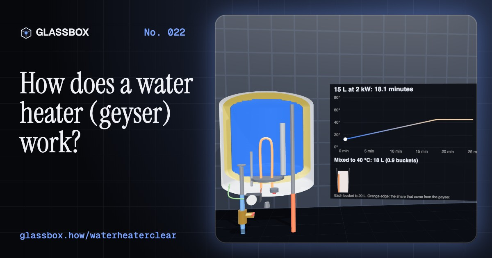
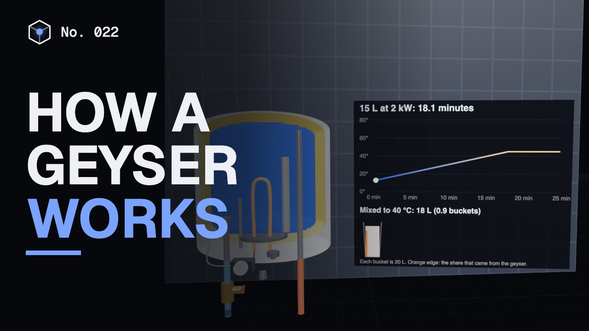
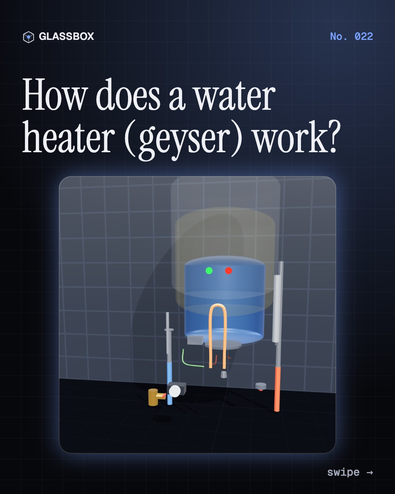
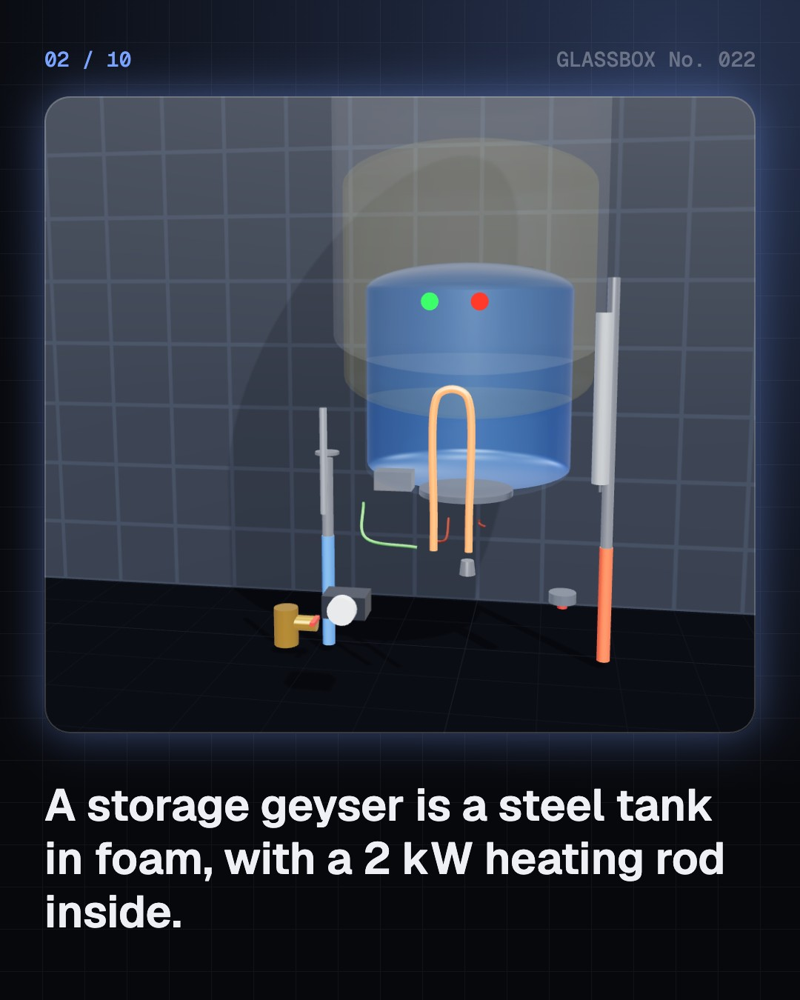
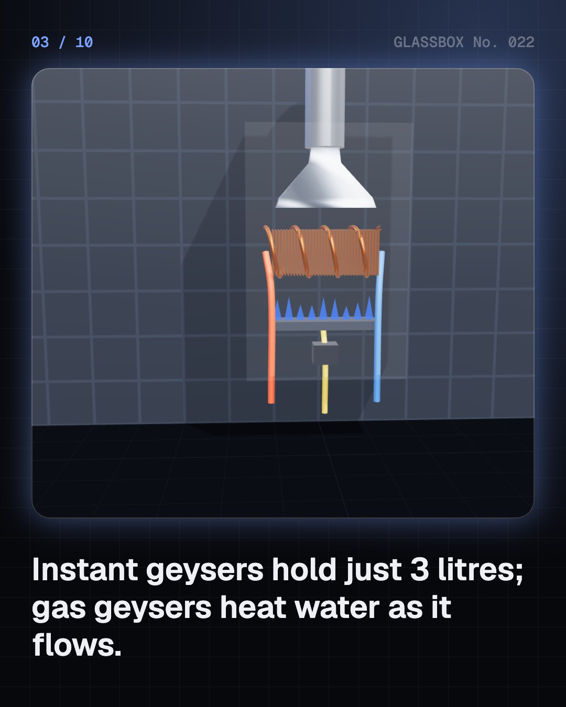
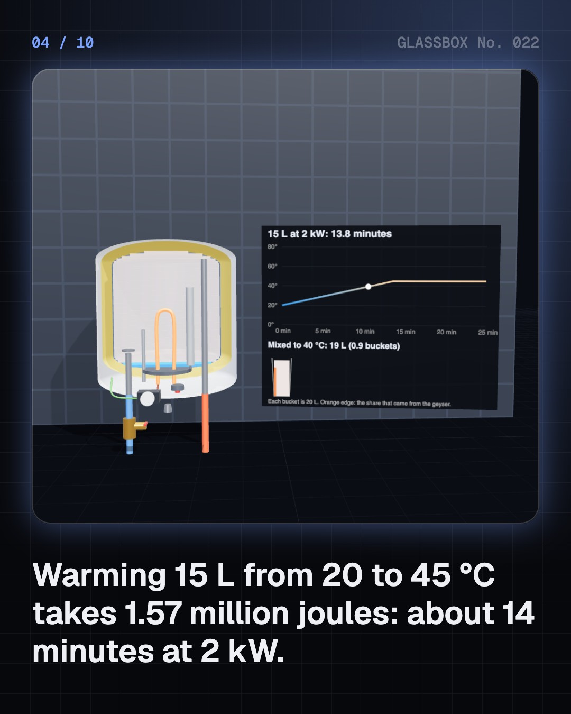

<!-- glassbox:start -->
<!-- Generated from glassbox.json by the Glassbox hub (npm run readme -- waterheaterclear). Edit glassbox.json, not this block. -->
<p align="center"><a href="https://glassbox-production-fd52.up.railway.app/e/waterheaterclear/"></a></p>

<h1 align="center">WaterHeaterClear</h1>

<p align="center"><b>How does a water heater (geyser) work?</b><br>A geyser is a flask with a 2 kW heater inside, and it quietly uses physics you can feel in the shower: hot water floats, water expands, and a magnesium rod dies to save the tank. Take one apart in 3D.</p>

<p align="center"><a href="https://glassbox-production-fd52.up.railway.app/waterheaterclear/"><b>▶ Play with it</b></a> &nbsp;·&nbsp; <a href="https://glassbox-production-fd52.up.railway.app/e/waterheaterclear/">Read the 60-second explainer</a> &nbsp;·&nbsp; <a href="https://glassbox-production-fd52.up.railway.app/waterheaterclear/glassbox/reel.mp4">Watch the 40-second video</a></p>

<p align="center">
  <a href="https://glassbox-production-fd52.up.railway.app/e/waterheaterclear/"></a>
  <a href="https://glassbox-production-fd52.up.railway.app/e/waterheaterclear/"></a>
  <a href="LICENSE"></a>
  <a href="LICENSE-CONTENT.md"></a>
  <a href="#privacy"></a>
</p>

## In 60 seconds

1. **A flask with a heater inside.** A storage geyser is a steel tank lined with glass, wrapped in foam and hung on the wall. A 2 kW heating element pokes up from the bottom, a thermostat switches it off at the temperature you set, and hot water leaves from the top.
2. **Water is hard to heat.** Every litre needs 4,180 joules for each degree. Warming 15 L from 20 to 45 °C takes 1.57 million joules: about 14 minutes at 2 kW, and nearly twice as long in winter, when the cold water starts colder.
3. **Hot water floats.** Water at 60 °C is about 1.5% lighter than at 20 °C, so the tank sorts itself into layers. Cold water enters at the bottom and pushes the hot layer out of the top, which is why the shower stays hot until it suddenly goes cold.
4. **Four things stand guard.** The thermostat does the everyday work. A thermal cut-out trips at about 85 to 90 °C if it fails, a relief valve lets out the water that expands as it heats, and an earthed body plus an RCCB cut the power if current leaks.
5. **A rod that dies for the tank.** A magnesium anode corrodes instead of the steel, so it has to be replaced every year or two. Hard water adds a second problem: calcium carbonate scale on the element, which makes it run hotter and burn out.
6. **Cheaper hot water.** A hot tank leaks heat all day, which is what India's BEE star label measures. Switching it off helps; a heat pump gives about three units of heat per unit of electricity, and a rooftop solar heater can do most of the work for free.

## Words worth knowing

| Term | Meaning |
|---|---|
| **Specific heat** | The energy needed to warm 1 kg of a substance by 1 °C. For water, about 4,180 joules. |
| **Heating element** | A resistance wire packed in powder inside a metal tube. Current through it makes heat: a 2 kW element at 230 V is about 26 Ω. |
| **Stratification** | Water settling into layers by temperature, hottest on top, because warm water is less dense. |
| **Thermocline** | The thin boundary between hot water above and cold water below in a tank. |
| **Thermostat** | A switch worked by temperature that turns the heater off at the set point and back on when the water cools. |
| **Pressure-relief valve** | A spring-loaded valve that lets water out when heating makes it expand and the pressure climbs too high. |
| **Sacrificial anode** | A magnesium rod that corrodes on purpose, protecting the steel tank it is bolted into. |
| **Scale** | Calcium carbonate that comes out of hard water when it is heated and coats the element. |
| **Standing loss** | Heat a full, hot tank loses in a day with no water drawn; the basis of India's BEE star rating for geysers. |

## A short history

**4,500 years from Roman furnaces and bronze boilers to the geyser on your bathroom wall, the solar tank on your roof and the heat pump that pulls warmth from the air.**

- **80 BCE** · Fire under the floor (Sergius Orata (attributed), Campania, Roman Republic (today Italy))
- **1868** · The first geyser (Benjamin Waddy Maughan, London, England)
- **1889** · A tank that keeps itself hot (Edwin Ruud, Pittsburgh, Pennsylvania, USA)
- **1891** · The Climax: sunshine in a box (Clarence Kemp, Baltimore, Maryland, USA)
- **1917** · An electric water heater with a thermostat (Ida Forbes, Los Angeles, California, USA)
- **1936** · Glass inside the tank (A. O. Smith, Milwaukee, Wisconsin, USA)
- **1980** · A law for sunny roofs (Government of Israel, Israel)
- **2001** · EcoCute: a heat pump that runs on carbon dioxide (CRIEPI, TEPCO, Denso and Corona, Japan)

The full story, with 27 moments, charts, people and 40 sources: [glassbox.how/e/waterheaterclear/history](https://glassbox-production-fd52.up.railway.app/e/waterheaterclear/history/). The data lives in [`history.json`](history.json).

## Video and slides

Made with the Glassbox studio from this box's storyboard (`window.glassbox.director`). Free to reuse under CC BY 4.0.

<a href="https://glassbox-production-fd52.up.railway.app/waterheaterclear/glassbox/video.mp4"></a>

<p><a href="glassbox/slide-1.jpg"></a> <a href="glassbox/slide-2.jpg"></a> <a href="glassbox/slide-3.jpg"></a> <a href="glassbox/slide-4.jpg"></a></p>

| File | What | Size |
|---|---|---|
| [`glassbox/reel.mp4`](https://glassbox-production-fd52.up.railway.app/waterheaterclear/glassbox/reel.mp4) | Reel / Short, with captions and soundtrack | 1080×1920 |
| [`glassbox/video.mp4`](https://glassbox-production-fd52.up.railway.app/waterheaterclear/glassbox/video.mp4) | YouTube video, with captions and soundtrack | 1920×1080 |
| `glassbox/slide-1…10.jpg` | Instagram carousel | 1080×1350 |
| `glassbox/thumb.jpg` | YouTube thumbnail | 1280×720 |
| `glassbox/cover.jpg` | Share card and repo social preview | 1200×630 |
| [`glassbox/history-reel.mp4`](https://glassbox-production-fd52.up.railway.app/waterheaterclear/glassbox/history-reel.mp4) | “History in 10 moments” Reel / Short | 1080×1920 |
| `glassbox/history-slide-*.jpg` | History carousel | 1080×1350 |
| `glassbox/post.json` | Post copy and schedule used by the publish kit | |

## Privacy

This box has no accounts and no ads, and it ships its own fonts and libraries. When you run it yourself it sends nothing anywhere. On glassbox.how, the site's `/bar.js` also loads Glassbox's analytics: **Google Analytics** to count visits (it asks first in the EU, UK and Switzerland, and stays off when your browser sends Global Privacy Control or Do Not Track) and **ClickTrust** to detect bots.

It remembers a few things **in your own browser only**, and never sends them anywhere:

| Browser storage key | What it holds |
|---|---|
| `waterheaterclear.v1` | Which chapters you have opened, your best quiz scores, and sound on or off. |

Exactly what each one sees is at [glassbox.how/privacy](https://glassbox-production-fd52.up.railway.app/privacy/).

## Licences

- **Code:** [MIT](LICENSE). Use it, change it, ship it.
- **Explanations, text, images and videos** (`glassbox.json`, `glassbox/`): [CC BY 4.0](LICENSE-CONTENT.md). Credit “Glassbox, glassbox.how/e/waterheaterclear”.
- **Third-party parts** keep their own licences: [three.js](https://threejs.org) (MIT), [Geist, Instrument Serif](https://openfontlicense.org) (SIL OFL 1.1).
- The Glassbox name and logo aren't covered by either licence. See the [terms](https://glassbox-production-fd52.up.railway.app/terms/).

Found a mistake? [Open an issue](https://github.com/bdeeps/waterheaterclear/issues). Corrections happen in public.
<!-- glassbox:end -->

## Run it

It's plain HTML, CSS and JavaScript. No build step and no dependencies. Run locally, it contacts no other website.

```bash
python3 -m http.server 8000
```

Three.js and the fonts ship in `vendor/` and `fonts/`, so it also works offline.

Then open http://localhost:8000.

## How it's built

| File | What |
|---|---|
| `index.html`, `css/app.css` | The page and its styles |
| `js/app.js`, `js/stage.js`, `js/ui.js`, `js/kit.js` | The shared Glassbox 3D engine: chapters, 3D stage, controls, quiz, video director |
| `js/chapters/*.js` | One file per chapter: the 3D model, controls, text, key terms, quiz and video scenes |
| `js/geyser.js` | Shared physics and parts: water density and heat-up maths, the layered (stratified) tank model, BEE star bands, and 3D storage, instant and gas geysers |
| `glassbox.json` | Title, question, explainer beats, key terms, browser storage and credits shown on glassbox.how |
| `reel` in each chapter | The storyboard the Glassbox studio records into short videos |
| `glassbox/` | The published video, slides, thumbnail and post copy |
| `fonts/`, `vendor/three/` | Self-hosted Geist and Instrument Serif (SIL OFL 1.1) and three.js (MIT) |
